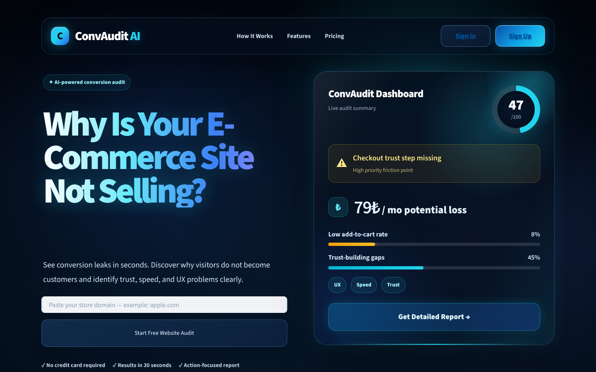

# ConvAudit

An AI-assisted conversion audit for e-commerce websites. Paste a store URL and get a scored
report that shows where visitors are likely dropping off, across user experience, trust,
content and performance, with a prioritised list of fixes.



## What it does

- **Audits a live page** — captures a full-page screenshot with a headless browser and has
  a vision model assess it against a fixed checklist
- **Scores it out of 100** — 25 criteria in four categories, each with its own weight and
  severity
- **Explains the result** — top issues, quick wins, a priority focus and an estimated
  improvement range
- **Tracks progress** — every audit is saved, so a later run on the same site shows what
  improved and what regressed
- **Exports a PDF report**
- **Accounts and plans** — sign-up and login, a free preview with a paywalled full report,
  and an admin panel with usage and error metrics
- **Turkish and English** interface

## The scoring model

The part of this project that took the most thought is how to score something a model can
only partly see. Each criterion gets one of five statuses:

| Status | Meaning | Points |
| --- | --- | --- |
| `PASS` | Clearly met | Full |
| `PARTIAL` | Partly met | Half |
| `FAIL` | Clearly absent or broken | None |
| `OPTIONAL` | Absent, but intentionally so for this type of site | Full |
| `UNKNOWN` | Cannot be verified from a screenshot (lives in the checkout, footer, etc.) | Half |

Two things follow from this:

- **Site type matters.** A luxury brand that shows no discount banner is not making a
  mistake, so the criterion is `OPTIONAL` instead of `FAIL`. The model first classifies the
  site (D2C, marketplace, luxury, SaaS, B2B, local business, content) and judges it in that
  light.
- **Uncertainty is reported, not hidden.** `UNKNOWN` gives the benefit of the doubt on the
  score but lowers a separate confidence percentage, so a report based on little visible
  evidence says so.

The criteria and the scoring rules live in [`services/criteria.py`](services/criteria.py).

## How it works

```
Streamlit UI (app.py, ui/)
      │
      ├─► Playwright      full-page screenshot of the target site
      ├─► OpenAI          vision model evaluates the screenshot against the criteria
      ├─► Scoring         criteria.py turns statuses into scores and a confidence level
      ├─► SQLite          users, audit history, telemetry
      └─► fpdf2           PDF report
```

| Area | Technology |
| --- | --- |
| UI | Streamlit with custom HTML and CSS |
| Screenshots | Playwright (Chromium) |
| AI | OpenAI API (`gpt-4o-mini`) |
| Storage | SQLite |
| Reports | fpdf2 |

## Getting started

Requirements: Python 3.11+ and an OpenAI API key.

```bash
git clone https://github.com/dilanhosgoren/convaudit.git
cd convaudit
pip install -r requirements.txt
playwright install chromium
```

Set the API key and start the app:

```bash
# macOS / Linux
export OPENAI_API_KEY=sk-...
# Windows PowerShell
$env:OPENAI_API_KEY="sk-..."

streamlit run app.py
```

The app opens at <http://localhost:8501>. The SQLite database is created in `data/` on the
first run. See [`.env.example`](.env.example) for the optional settings; they are read as
environment variables.

Each audit makes one vision request to the OpenAI API, which is billed to your key.

## Project layout

```
app.py              pages, routing and the audit flow
ui/                 global styles and reusable UI components
services/           AI analysis, criteria and scoring, auth, history, PDF, telemetry
utils/              response parsing helpers
config/             model settings and interface translations
```

## Known limitations

- The audit sees one screenshot of one page. Anything behind a click (checkout, product
  pages) is marked `UNKNOWN`.
- The improvement range is an estimate, not a measurement.
- `app.py` and `ui/styles.py` are large single files; splitting them into pages and
  stylesheets is the next refactor.
- Payment is linked out to a checkout URL; there is no built-in billing.
- This repository is the application itself. It was built to sit behind a separate
  marketing site, which is not included; the app also runs on its own.

## License

[MIT](LICENSE)
